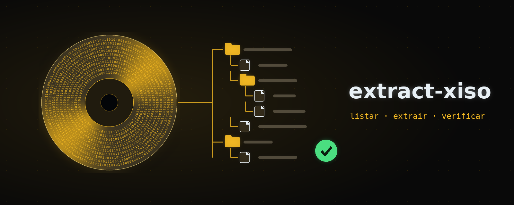

# extract-xiso-pt

[](https://github.com/lux-insider/extract-xiso-pt/releases/latest)
[](LICENSE)




Ferramenta para imagens de disco de **Xbox** e **Xbox 360** (sistema de
arquivos XDVDFS), em **Rust** e em português: **listar**, **extrair**,
**criar** a partir de uma pasta, **reescrever** como XISO enxuta e
**verificar** a integridade, inclusive contra os `.dat` do Redump.

É uma implementação independente, escrita a partir da documentação pública
do formato. O resultado foi validado por comparação de saídas com o
`extract-xiso` em imagens de teste e jogos reais, sem uso do código-fonte
dele.

---

## Sumário

- [Recursos](#recursos)
- [Download](#download)
- [Uso](#uso)
- [Códigos de saída](#códigos-de-saída)
- [Integração com outros programas](#integração-com-outros-programas)
- [Problemas e sugestões](#problemas-e-sugestões)
- [Licença](#licença)

---

## Recursos

- **Todos os layouts**: XISO, XGD1 (Xbox), XGD2 e XGD3 (Xbox 360), detectados
  sozinhos.
- **`extrair`** igual byte a byte ao `extract-xiso` (conferido nos 3696
  arquivos do Resident Evil 5 e em imagens de teste de Xbox), no mesmo tempo.
- **`criar`** uma XISO a partir da pasta de um jogo de Xbox ou de Xbox 360,
  que o `extract-xiso` oficial e o iso2god-pt leem normalmente.
- **`reescrever`** um disco completo como XISO enxuta: tira a partição de
  vídeo e o espaço vazio (o RE5 foi de 7,30 GiB para 6,71 GiB, com os 3696
  arquivos idênticos ao original).
- **`verificar`** a integridade: estrutura inteira, leitura de todos os bytes
  e hashes CRC32, MD5 e SHA-1 — e, com `--dat`, a comparação com um `.dat` do
  [Redump](http://redump.org), dizendo se a imagem é a do disco original.
- **Liberar a mídia do XBE**, só como opção (`--liberar-midia`, desligado por
  padrão), só na cópia dentro da imagem nova.
- **Segura com imagens estranhas ou maliciosas.** Nomes que sairiam da pasta
  de destino (`..`, `/`, `C:`), nomes que o Windows não aceita, laços na
  árvore, profundidade absurda, tabelas compartilhadas e trechos além do fim
  do arquivo viram um erro explicado, antes de gravar qualquer coisa. A
  extração nunca grava através de um link simbólico (ou junção) que já
  esteja no destino. Testado com milhares de imagens corrompidas de
  propósito.
- **Nada pela metade.** Ctrl+C, SIGTERM, fechar o terminal ou a janela do
  console e qualquer falha apagam o que a operação criou. Um arquivo
  incompleto nunca fica com o nome de pronto, e uma imagem nova só ganha o
  nome final depois de gravada e relida.
- **Erros que dizem o que houve:** qual arquivo, qual operação e a causa
  (não existe, sem permissão, disco cheio...).
- Espaço livre conferido antes de começar, em vez de falhar a 90%.
- Protocolo `--progresso-json`, o mesmo do iso2god-pt, para outro programa
  (como o xiso-manager) mostrar a barra de progresso.

---

## Download

Baixe a versão mais recente na página de
[**Releases**](https://github.com/lux-insider/extract-xiso-pt/releases/latest).

| Arquivo | Sistema |
|---|---|
| `extract-xiso-pt-linux-x86_64` | Linux x86_64 (glibc 2.34+) |
| `extract-xiso-pt-windows-x86_64.exe` | Windows 10 e 11 (64 bits) |
| `SHA256SUMS.txt` | hashes para conferir os downloads |

No Linux, dê `chmod +x` no binário. No Windows não é preciso instalar nada: o
`.exe` não depende do Visual C++ Redistributable.

---

## Uso

```bash
# informações: layout, console, data, conteúdo
extract-xiso-pt info jogo.iso

# listar sem extrair (ou a árvore inteira em JSON com --json)
extract-xiso-pt listar jogo.iso

# extrair (sem -d: numa pasta com o nome da imagem, ao lado dela)
extract-xiso-pt extrair jogo.iso -d pasta/
extract-xiso-pt extrair jogo.iso -s              # sem a pasta $SystemUpdate

# criar uma XISO a partir de uma pasta (sem -s: pasta.iso ao lado dela)
extract-xiso-pt criar pasta/ -s jogo.iso

# disco completo -> XISO enxuta (sem -s: jogo.xiso.iso ao lado)
extract-xiso-pt reescrever jogo.iso
extract-xiso-pt reescrever jogo.iso --substituir # troca o original, só no fim

# .dat do Redump: instale uma vez (aceita o .zip baixado do site)
extract-xiso-pt dats instalar "Microsoft - Xbox 360 - Datfile (3691).zip"
extract-xiso-pt dats                             # mostra os instalados

# integridade e hashes; com os .dat instalados, diz se é a imagem original
extract-xiso-pt verificar jogo.iso
extract-xiso-pt verificar jogo.iso --dat outro.dat   # um .dat específico
extract-xiso-pt verificar jogo.iso --sem-dat         # só a integridade
```

`criar` e `reescrever` aceitam `-u`/`--sem-atualizacao` (deixa a
`$SystemUpdate` de fora) e, para jogos de Xbox, `--liberar-midia`.

### Sobre o `.dat` do Redump

Baixe os .dat em [redump.org/downloads](http://redump.org/downloads/)
("Microsoft - Xbox" e "Microsoft - Xbox 360") e instale com `dats instalar`.
Eles não vêm junto com o programa: o Redump atualiza os .dat sempre, e
instalando você fica com a versão mais nova (a antiga do mesmo console é
trocada). Ficam em `~/.local/share/extract-xiso-pt/dats` no Linux,
`%APPDATA%\extract-xiso-pt\dats` no Windows, ou numa pasta `dats` ao lado do
executável.

O Redump cataloga **discos completos**. Uma imagem com o tamanho de um disco
XGD completo pode conferir; uma XISO enxuta (de `reescrever` ou de outra
ferramenta) tem outros bytes e nunca confere. O `verificar` avisa isso.

### Sobre `--liberar-midia`

O certificado do `default.xbe` diz de quais mídias o jogo aceita rodar. A
opção acrescenta o disco rígido e os DVD/CD gravados a esse campo, **só na
cópia dentro da imagem nova**: a pasta ou imagem de origem não muda. O
certificado é assinado, então isso serve para console desbloqueado ou
emulador, e a imagem deixa de ser idêntica ao disco. Por isso é opção, e não
o padrão.

---

## Códigos de saída

| Código | Significado |
|---|---|
| 0 | tudo certo |
| 1 | erro (imagem inválida, destino ocupado, sem espaço, opção desconhecida...) |
| 2 | `verificar`: o Redump tem este jogo com outro SHA-1 (modificado, corrompido ou outra versão); com `--dat`, também quando a imagem não está no .dat |
| 130 | cancelado (Ctrl+C, SIGTERM, terminal ou janela fechados, ou entrada fechada com `--cancelar-pela-entrada`) |

---

## Integração com outros programas

```bash
extract-xiso-pt extrair jogo.iso -d pasta/ --progresso-json
extract-xiso-pt verificar jogo.iso --progresso-json   # relatório no evento "verificado"
extract-xiso-pt info jogo.iso --json
```

Com isso, o programa emite uma linha JSON por evento em stdout: `fase`,
`progresso` (bytes, velocidade e ETA), `concluido` ou `erro`. É o mesmo
protocolo do [iso2god-pt](https://github.com/lux-insider/iso2god-pt), usado pelo
[xiso-manager](https://github.com/lux-insider/xiso-manager) para a barra de progresso.

Para cancelar sem console (um programa com janela, no Windows, não tem como
mandar Ctrl+C), use `--cancelar-pela-entrada`, ligue um pipe na entrada
padrão e feche-o: a operação para no próximo ponto seguro, apaga o que
criou e sai com 130.

---

## Problemas e sugestões

Erros e ideias são bem-vindos nas [issues](https://github.com/lux-insider/extract-xiso-pt/issues/new/choose),
com um modelo para cada caso. Para falhas de segurança, veja o
[SECURITY.md](SECURITY.md).

---

## Licença

Programa **gratuito (freeware)**, de código fechado: pode usar à vontade, mas
não pode vender, republicar em outros sites nem modificar. Os termos completos
estão no [LICENSE](LICENSE).
